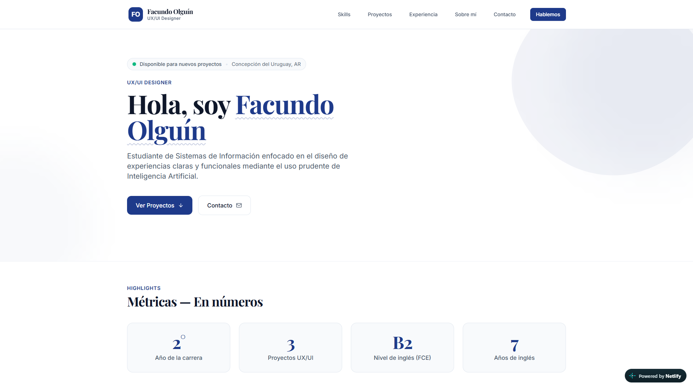
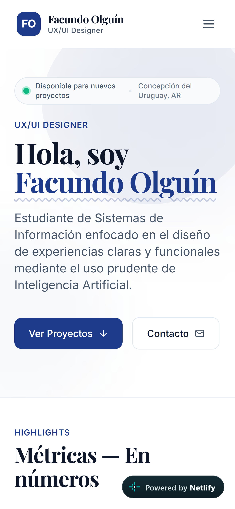
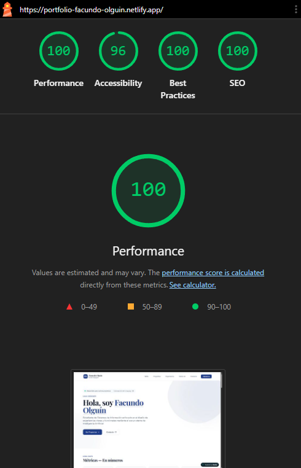
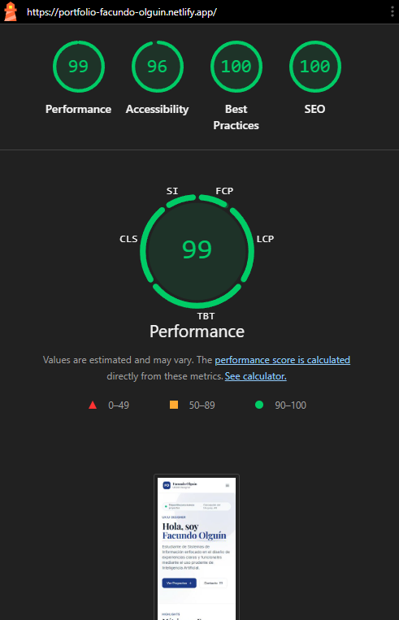
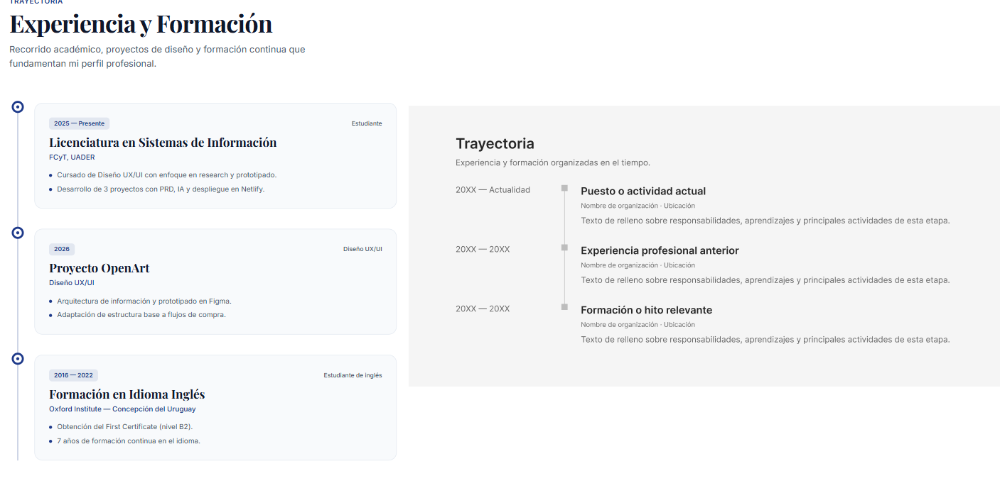
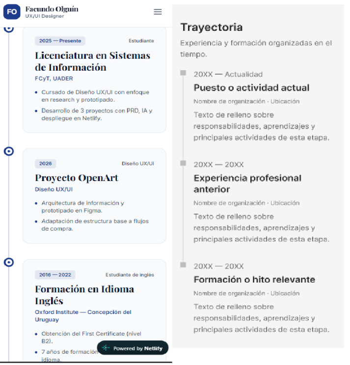

# Portfolio Personal — Facundo Federico Olguín

> **UX/UI Designer & Estudiante de Sistemas de Información**  
> Diseño de experiencias digitales claras, funcionales y accesibles mediante el uso reflexivo y prudente de Inteligencia Artificial. Concepción del Uruguay, Entre Ríos, Argentina.

---

## 🌐 Enlaces del Proyecto

- **Sitio Web en Producción (Netlify):** [https://portfolio-facundo-olguin.netlify.app/](https://portfolio-facundo-olguin.netlify.app/)
- **Diseño del Sistema en Figma:** [Figma Design File](https://www.figma.com/design/bet43zNQs5e2NpfKDEXOsD/Dise%C3%B1o-base-Portfolio?node-id=0-1&t=hu7rAodSGAmQJlRJ-1)
- **Repositorio del portfolio:** [https://github.com/facuolgg/UX-UI/tree/main/portfolio-personal](https://github.com/facuolgg/UX-UI)

---

## 📸 Vista Previa del Sitio en Desktop

<!-- Captura de pantalla de la versión Desktop y Mobile del portfolio -->



---
## 📸 Vista Previa del Sitio en Mobile
<!-- Captura de pantalla de la versión Mobile del portfolio -->

---

## 🛠️ Stack Tecnológico

- **Estructura:** HTML5 semántico (`<header>`, `<main>`, `<section>`, `<article>`, `<footer>`).
- **Estilos & Diseño:** [Tailwind CSS v3](https://tailwindcss.com/) compilado mediante CLI nativo (sin dependencias en tiempo de ejecución ni CDNs pesados).
- **Interacciones & Lógica:** JavaScript Vanilla (ES6+) para el menú responsive mobile, modal accesible de caso de estudio con trampa de foco (*focus trap*), y manejo accesible de teclado.
- **Iconografía:** [Lucide Icons](https://lucide.dev/) integrados en formato SVG inline (cero peticiones HTTP externas adicionales).
- **Tipografía:** Google Fonts con estrategia `font-display: swap` (*Playfair Display* para jerarquía editorial y títulos serif, e *Inter* para lectura sans-serif de alto rendimiento).
- **Alojamiento & CI/CD:** [Netlify](https://www.netlify.com/) con compilación automatizada (`netlify.toml`).

---

## 🎨 Sistema de Diseño (Design System)

- **Primario:** `#1E3A8A` (Azul Marino Editorial)
- **Fondo:** `#FFFFFF` (Blanco Puro)
- **Tarjetas:** `#F8FAFC` (Slate 50)
- **Texto Principal:** `#0F172A` (Slate 900)
- **Texto Secundario:** `#475569` (Slate 600)
- **Bordes y Delimitadores:** `#E2E8F0` (Slate 200)
- **Breakpoints (Mobile-First):** `sm: 375px`, `md: 768px`, `xl: 1280px`.

---

## 🚀 Instalación y Desarrollo Local

1. **Clonar el repositorio:**
   ```bash
   git clone https://github.com/facuolgg/UX-UI.git
   cd UX-UI/portfolio-personal
   ```

2. **Instalar dependencias de desarrollo:**
   ```bash
   npm install
   ```

3. **Modo observador para desarrollo (compilación en vivo de Tailwind):**
   ```bash
   npm run watch:css
   ```

4. **Compilar versión final para producción:**
   ```bash
   npm run build:css
   ```

---

## ☁️ Proceso de Despliegue en Netlify

El proyecto cuenta con el archivo `netlify.toml` preconfigurado en la raíz:

```toml
[build]
  command = "npm run build:css"
  publish = "."
```

### Pasos para desplegar:
1. Conectar el repositorio de GitHub con **Netlify**:
   - Ingresar a [app.netlify.com](https://app.netlify.com/) y seleccionar **"Add new site" > "Import an existing project"**.
   - Elegir el proveedor **GitHub** y seleccionar el repositorio `UX-UI`.
   - Establecer como **Base directory** (si aplica) `portfolio-personal`.
2. Netlify detectará automáticamente el archivo `netlify.toml`:
   - **Build command:** `npm run build:css`
   - **Publish directory:** `.` (o `portfolio-personal` según el root)
3. Hacer clic en **Deploy Site**.
4. Cada push posterior a la rama `main` generará un despliegue continuo automático.

---

## 🖼️ Optimización de Imágenes (Hoja de Ruta WebP)

> **Nota de ingeniería:** Para la entrega inicial se conservaron los archivos fuente en formato `.png` y `.jpg` en `assets/img/`.
## 📊 Auditoría Lighthouse (Desktop)

### Resultados y Cumplimiento Actual:
- **Performance:** 100/100
- **Accesibilidad:** 96/100
- **SEO:** 100/100
- **Mejores Prácticas:** 100/100


---

## 📊 Auditoría Lighthouse (Mobile)

### Resultados y Cumplimiento Actual:
- **Performance:** 99/100
- **Accesibilidad:** 96/100
- **SEO:** 100/100
- **Mejores Prácticas:** 100/100


---

## Comparación de la sección trayectoria del portfolio con el figma (Desktop)



## Comparación de la sección trayectoria del portfolio con el figma (Mobile)



## 🤖 Declaración de Uso de Inteligencia Artificial

En concordancia con los principios de transparencia académica y profesional:

- **Herramientas empleadas:** Asistentes de IA (VSCode Copilot, Deepseek, Antigravity IDE y Figma AI) fueron utilizados como aceleradores de exploración metodológica, prototipado rápido y asistencia en la maquetación.
- **Criterio rector humano:** Todas las decisiones arquitectónicas, modelado de sistemas de diseño, definición de esqueletos de información, accesibilidad y resolución de flujos de interacción fueron planificadas, dirigidas y supervisadas por **Facundo Federico Olguín**. La IA actuó como herramienta de ejecución y apoyo, nunca en reemplazo del pensamiento crítico y el criterio de diseño centrado en las personas.

---

## 📄 Licencia

Distribuido bajo licencia [ISC](LICENSE). Realizado para la cátedra de **UX/UI - Segundo Año de Sistemas de Información**.
