# Cubrí Seguros — Flujo de Contratación Digital (Arquitectura Multipágina)

Implementación front-end del flujo completo de contratación digital de seguros para **Cubrí Seguros**, cumpliendo estrictamente con la especificación del trabajo práctico de UX/UI (Licenciatura en Sistemas de Información, FCyT - 2026).

El proyecto fue refactorizado a una **arquitectura multipágina (MPA)** real donde cada pantalla reside en su propio archivo HTML independiente y el estado se sincroniza de forma transparente a través de `localStorage`.

---

## 🛠️ Stack Tecnológico

- **HTML5 semántico**: Estructura accesible con `aria-invalid`, `aria-describedby`, `role="alert"` y etiquetas `<label for>`.
- **Tailwind CSS v4 (Browser CDN)**: Utilidades de layout responsive y espaciado mobile-first.
- **Basecoat UI (CDN)**: Sistema de diseño de componentes (estilo shadcn/ui en HTML + Tailwind).
- **JavaScript Vanilla (ES Modules)**: Módulos estándar nativos sin frameworks ni librerías de validación de terceros.
- **Persistencia Nativa**: `localStorage` para hidratar y guardar el estado de la solicitud entre navegaciones.
- **Tokens de Diseño**: Sobrescritura de variables CSS (`--primary: #4F46E5`, `--radius: 0.75rem`, etc.) y tipografía **Inter**.

---

## 📂 Estructura del Proyecto

```text
seguros/
├── index.html              # Pantalla 01: Inicio / Catálogo de productos
├── cotizacion.html         # Pantalla 02: Cotizar celular (Paso 1 del checkout)
├── planes.html             # Pantalla 03: Selección de plan (Paso 2 del checkout)
├── datos.html              # Pantalla 04: Datos personales del titular (Paso 3)
├── pago.html               # Pantalla 05: Medio de pago y simulación (Paso 4)
├── exito.html              # Pantalla 06: Confirmación de póliza emitida
├── error-pago.html         # Pantalla 07: Rechazo de pago y opciones de reintento
├── css/
│   └── tokens.css          # Variables CSS, overrides de Basecoat y tipografía Inter
├── data/
│   └── planes.json         # Datos de los planes (cargados mediante fetch)
├── js/
│   ├── app.js              # Enrutador central, listeners por página y guardas de ruta
│   ├── estado.js           # Objeto solicitud, persistencia (guardar/cargar) y navegarA()
│   ├── render.js           # Renderizado condicional tolerante, Stepper y resumen
│   ├── validaciones.js     # Funciones puras de validación de formulario
│   ├── cotizador.js        # Cálculo de cuotas mensuales y formateo de moneda ARS
│   └── pago.js             # Simulación de pasarela de pago asíncrona y póliza
└── README.md
```

---

## 🧭 Migración a Multipágina y Decisión de Arquitectura JS

### Decisión de Entry: Enrutador Centralizado en `js/app.js` (Opción B)
Para la integración JavaScript entre páginas se optó por un único entry `js/app.js` que detecta la pantalla activa mediante el atributo `data-page` en `<body>` (`catalogo`, `cotizacion`, `planes`, `datos`, `pago`, `exito`, `error-pago`).

**Justificación técnica:**
1. **DRY y Mantenibilidad**: Evita la fragmentación en múltiples archivos de entrada diminutos y repetitivos (`js/pages/cotizacion.js`, etc.), centralizando el ciclo de vida de la aplicación.
2. **Guardas de Ruta Centralizadas**: Facilita verificar de forma unificada si el usuario intenta ingresar directamente por URL a una pantalla avanzada (ej. `datos.html` o `pago.html`) sin haber completado los pasos previos requeridos, redirigiéndolo con `window.location.replace()`.
3. **Consistencia de Carga**: Todas las páginas comparten la misma referencia de script `<script type="module" src="js/app.js"></script>`, garantizando una hidratación idéntica desde `localStorage` antes de inicializar la vista.

---

## Capturas de pantalla

Muestra visual del flujo completo de contratación digital tanto en versión mobile (390px) como desktop (1440px).

### Flujo de contratación

### 01 · Inicio / Catálogo

| Mobile (390px) | Desktop (1440px) |
|---|---|
| 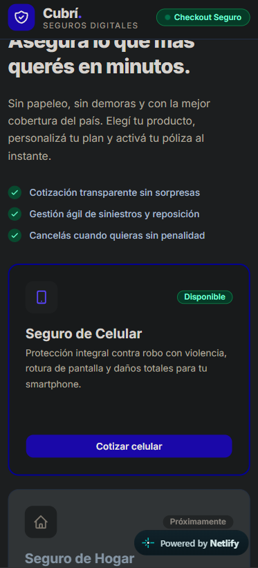 | 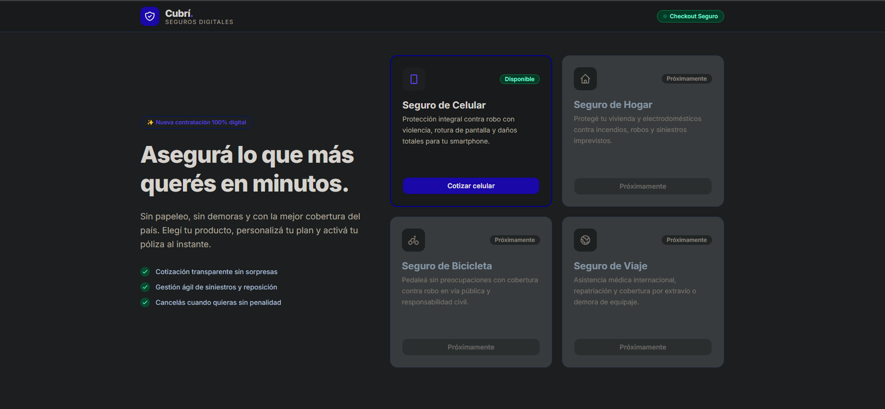 |

### 02 · Cotizar (Paso 1)

| Mobile (390px) | Desktop (1440px) |
|---|---|
| 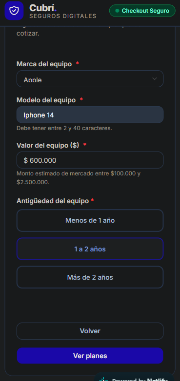 | 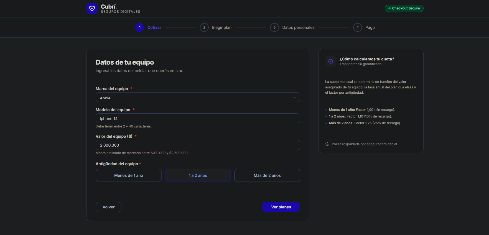 |

### 03 · Elegir plan (Paso 2)

| Mobile (390px) | Desktop (1440px) |
|---|---|
| 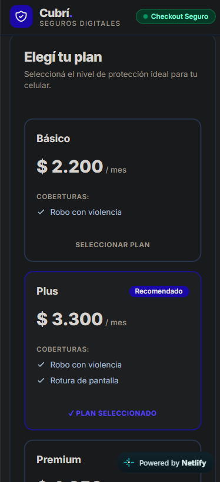 | 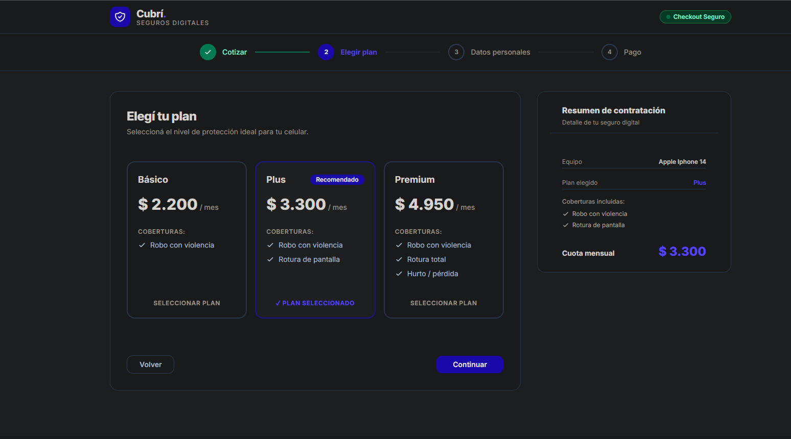 |

### 04 · Datos personales (Paso 3)

| Mobile (390px) | Desktop (1440px) |
|---|---|
| 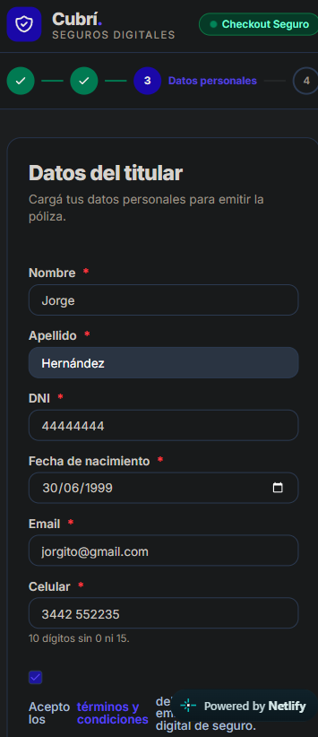 | 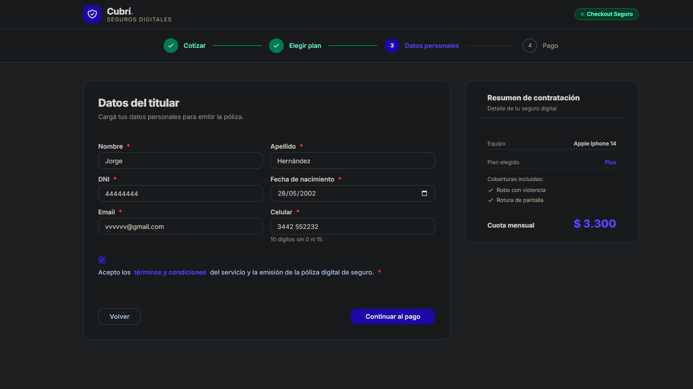 |

### 05 · Pago (Paso 4)

| Mobile (390px) | Desktop (1440px) |
|---|---|
| 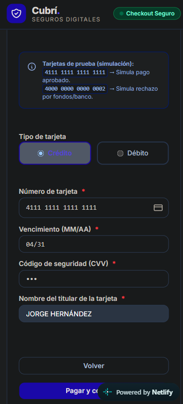 | 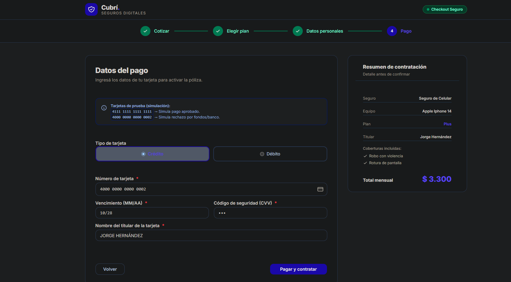 |

### 06 · Éxito

| Mobile (390px) | Desktop (1440px) |
|---|---|
| 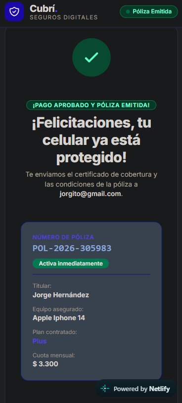 | 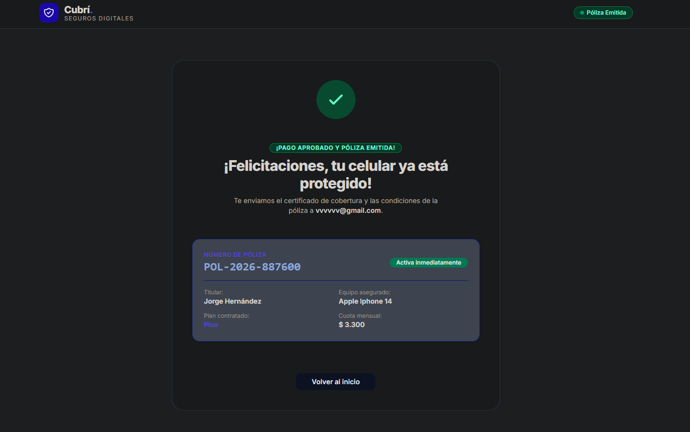 |

### 07 · Error de pago

| Mobile (390px) | Desktop (1440px) |
|---|---|
| 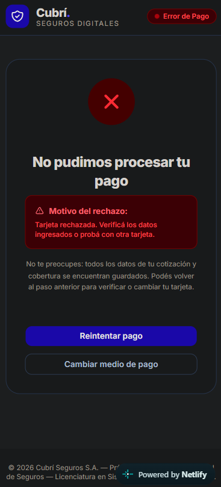 | 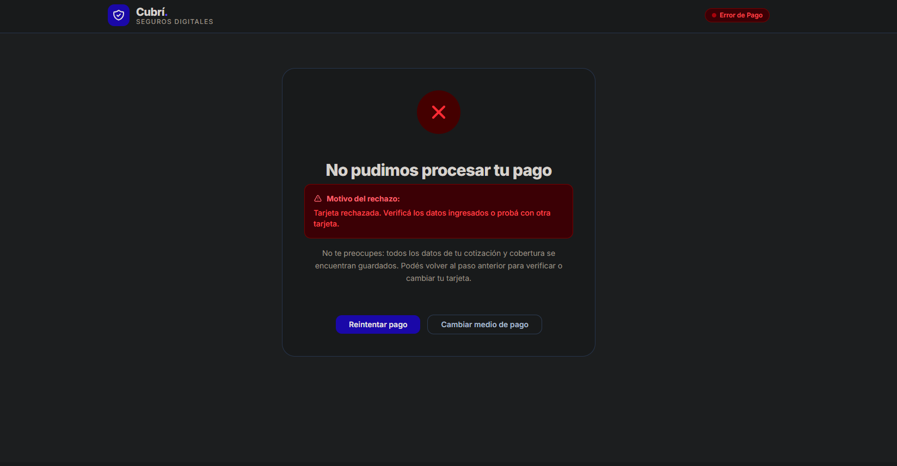 |

---

## 🚀 Cómo ejecutar el proyecto

Dado que el proyecto utiliza módulos ES (`<script type="module">`) y carga los planes mediante `fetch('data/planes.json')`, debe ejecutarse a través de un servidor local (para evitar bloqueos CORS por protocolo `file://`).

### Opción 1: Con Python
```bash
python -m http.server 3000
```
Abrir `http://localhost:3000` en el navegador.

### Opción 2: Con Node.js / npx serve
```bash
npx serve .
```

### Opción 3: Con VS Code Live Server
Abrir la carpeta en VS Code y hacer clic en **"Go Live"** en la barra inferior.

---

## 🧮 Reglas de Negocio y Casos de Prueba

### Fórmula de Cuota Mensual
$$\text{cuota} = \text{Math.round}\left(\text{valor} \times \frac{\text{tasaAnual}}{12} \times \text{factorAntiguedad}\right)$$

### Factores de Antigüedad
- **Menos de 1 año:** Factor $1.00$
- **1 a 2 años:** Factor $1.10$
- **Más de 2 años:** Factor $1.25$

### Verificación de Casos de Prueba (Sección 5.1 del PDF)
| Valor del equipo | Antigüedad | Básico (4%) | Plus (6%) | Premium (9%) |
| :--- | :--- | :--- | :--- | :--- |
| **\$ 600.000** | Menos de 1 año | **\$ 2.000** | **\$ 3.000** | **\$ 4.500** |
| **\$ 600.000** | 1 a 2 años | **\$ 2.200** | **\$ 3.300** | **\$ 4.950** |
| **\$ 1.200.000** | Más de 2 años | **\$ 5.000** | **\$ 7.500** | **\$ 11.250** |

---

## 💳 Simulación de Pago y Pólizas

### Tarjetas de Prueba
- `4111 1111 1111 1111` → **Aprobado**: Lleva a `exito.html` y genera una póliza única con formato `POL-AAAA-NNNNNN`.
- `4000 0000 0000 0002` → **Rechazado**: Lleva a `error-pago.html` con mensaje descriptivo y botones para reintentar o cambiar de tarjeta conservando los datos cargados.
- Cualquier otra tarjeta válida de 16 dígitos → **Aprobado**.

---

## 📱 Diseño Responsive y Accesibilidad

- **Mobile First (390px)**: Una columna, controles de fácil toque y botón de acción principal destacado.
- **Desktop (1440px)**: Grid en dos columnas (`lg:grid-cols-[1fr_380px]`) con formulario principal a la izquierda y card de resumen lateral persistente a la derecha (`planes.html`, `datos.html`, `pago.html`).
- **Accesibilidad**:
  - Formularios con etiquetas semánticas vinculadas (`<label for>`).
  - Validación en tiempo real al salir del campo (`blur`) con feedback accesible (`aria-invalid="true"`, `aria-describedby` y `role="alert"`).
  - Enfoque programático en el primer campo inválido ante un intento de avance.
  - Máscaras automáticas para formato de tarjeta de crédito (bloques de 4) y fecha de vencimiento (`MM/AA`).

## Checklist de entrega

- [x] Las 7 pantallas existen y se ven bien en 390px y 1440px.
- [x] Los 3 casos de prueba de la sección 5.1 dan exactamente el valor esperado.
      (verificado en `js/cotizador.test.js` o manualmente — indicar cómo)
- [x] No se puede avanzar con datos inválidos y cada error tiene su mensaje.
- [x] "Volver" conserva los datos en todos los pasos.
- [x] La tarjeta `4000 0000 0000 0002` lleva al error y "Reintentar" vuelve al pago con todo cargado.
- [x] La póliza tiene formato `POL-AAAA-NNNNNN`.
- [x] No hay errores en la consola del navegador.
- [x] El sitio está publicado y el README tiene capturas y la URL.